# Chart reference

**For:** the people who read charts: engineers using an app built on wafermap, and developers deciding which chart to put in front of them.

Every chart, table and map the library draws, with what it shows, why you would reach for it, how to read it and where it goes wrong. Each entry starts with the same one line the app shows under **About this chart**, so the page and the app say the same thing. To see them all drawn, open the [Chart gallery](examples/insights.html); the statistics behind them are explained in the [user guide](user-guide.md#10-the-statistics-explained).

A **chart** here is anything drawn with marks and axes. A **plot** is a chart you build and keep on the **My plots** tab, and each entry says how to make its chart there. A **card** is the frame a chart sits in on the Insights grid.

## Using a plot's JSON

A plot is a small recipe: its chart type and what goes on each axis. Where an entry shows one as JSON, it is the same plot the **My plots** editor builds, which has no box to type JSON into. There are two ways to use it:

- **In an application:** the developer passes it in the `insights.plots` list, and it is drawn on the **My plots** tab of every map and gallery.
- **In a file:** save plots as a list in a text file, `[ { … }, { … } ]`, and bring them in with **My plots ▸ Import plots…**. A plot without an `id` is given one, and the import says so. **Export plots…** writes the same format, so a plot you have built shows what its JSON looks like.

The test numbers and wafer attributes in the examples (`1060`, `processSplit`) are those of the example lot; use your own. The [Chart gallery](examples/insights.html) supplies one plot of each chart type this way.

---

---

## Maps

### Bin map

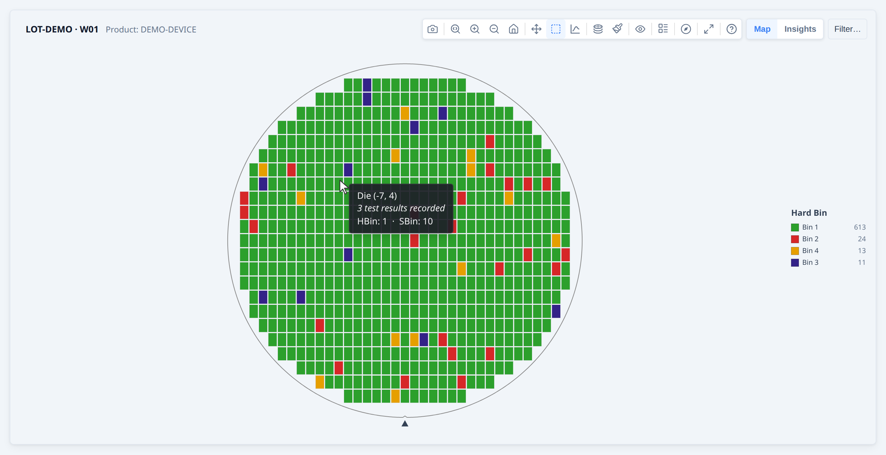

*Each die coloured by its hard or soft bin, passing bins in greens and failing bins in other colours, to show where the failures are.*

**Why it is useful.** A wafer's yield is one number; the bin map says where the loss is. A ring of one failing bin at the edge, a scratch across the middle and a scatter of single dies are different problems with the same yield, and only the map tells them apart. It is the first thing to open on a new wafer and the map the other charts return to when you click a mark.

**How to read it.** Green means the die passed (its bin is one of the wafer's pass bins); every other colour is a failing bin. A bin keeps its colour on every wafer and every lot of the same program, so bin 7 is the same colour in every gallery and screenshot: you can learn your program's colours. The legend lists the pass bins first, then the failing bins from the most dies down, each with its count and share. Click a swatch to dim every other bin; click it again to clear. Grey is a die with no result, which is not a fail. Dimmed dies at the rim lie in the edge-exclusion band, and dies a filter drops are drawn faded; neither is counted in the yield beside the map.

**Notes.**

- **Colour is fixed by the bin number, so two bins far apart in number can share a colour** once a palette runs out. When two of them are on screen together the **Data warnings** button says so; use the legend or the tooltip to tell them apart.
- **Hard and soft bins are different maps.** Hard bin 3 and soft bin 3 are different colours and rarely the same dies.
- **Which bins pass is the data's statement, not a guess.** The wafer's pass bins decide the greens and the yield, so a wafer built with other pass bins colours the same bin differently. The yield label names the pass bins in use.
- **A uniform scatter and a pattern can look alike on one wafer.** Look at several wafers, or the stacked map, before reading a pattern as real.

**Where to find it.** Open **Plot mode** on a map or a gallery's toolbar and choose **Hard bin** or **Soft bin**; a map opens on it when its data has bins. Every card of a gallery shares the choice and the colours.

**See also.** [Test value map](#test-value-map), [Bin pareto](#bin-pareto). The [Chart gallery](examples/insights.html) shows the live charts; [Display and interaction](guide/display.md) covers the legend and the colour schemes.

### Test value map

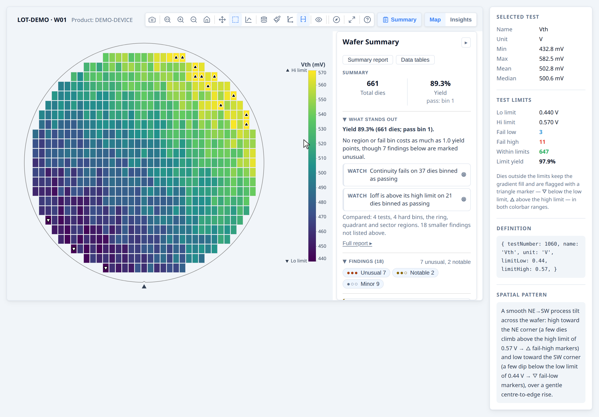

*Each die coloured by one test’s value on a colour scale, with the test’s limits on the colour bar, to show where on the wafer the value shifts.*

**Why it is useful.** Bins say whether a die passed; a test value map says *by how much*, and where. A gradient across the wafer, a roll-off at the edge or a pattern that repeats with the reticle shows up here while every die still passes, and it is often the first sign of what the bin map will show later.

**How to read it.** The colour of a die is the value of the chosen test, read against the colour bar. Where the test has limits they are marked on the bar, and a die outside them carries a triangle: ▽ below the low limit, △ above the high one, drawn in black or white to show against its own colour. The colour bar can run over the **limits** (the same colours mean the same value on every wafer, so maps compare) or over the **data** (more contrast on this wafer, but not comparable with another). The [limit pass/fail map](#limit-passfail-map) replaces the gradient with categories, and a go/no-go test, which has no value, is shown by the verdict the tester recorded in the [test pass/fail map](#test-passfail-map). Grey is a die with no value for the test, including a value outside the test's validity limits, which is treated as no reading.

**Notes.**

- **The data range is not comparable between wafers.** It stretches the colours to the values present, so the same colour means a different value on the next wafer.
- **A log scale needs positive values.** The **Log scale** button takes effect only when every value shown is positive.
- **Triangles are left off dies too small to carry one** (under 5 pixels, as on a dense wafer zoomed out); the colour bar says so, and zooming in brings them back.
- **A derived test is marked †** wherever it is named, so a computed value is never taken for a measured one.

**Where to find it.** Open **Plot mode** on a map or a gallery's toolbar and choose a test; with many tests the list has a filter box. In a gallery every card shows the same test.

**See also.** [Bin map](#bin-map), [Limit pass/fail map](#limit-passfail-map), [Test pass/fail map](#test-passfail-map), [Value histogram](#value-histogram).

### Limit pass/fail map

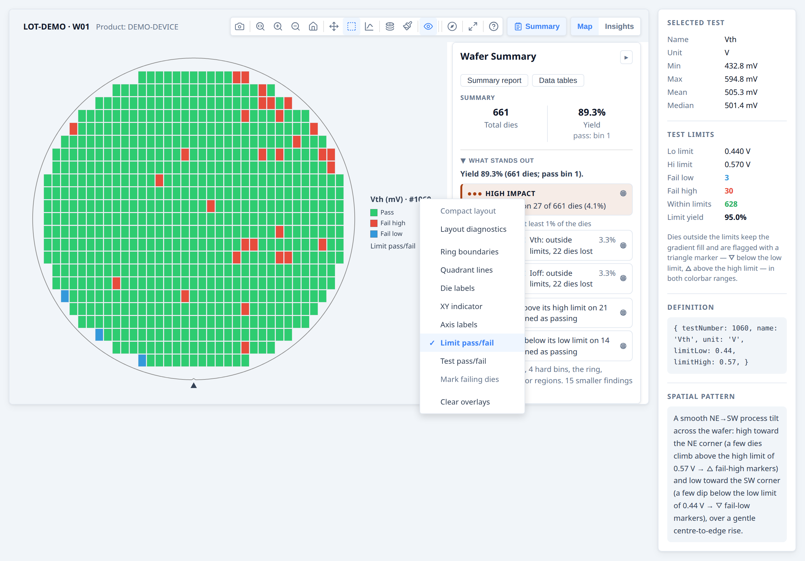

*Each die coloured by whether its value for one test lies inside the test’s limits, with the dies below the low limit and above the high limit marked apart, to show where a test fails its limits.*

**Why it is useful.** The [test value map](#test-value-map) shows how much; this one answers the plainer question, "which dies fail this test, and on which side?". A cluster below the low limit and a scatter above the high one are different problems, and the gradient makes both hard to see when most values are in range.

**How to read it.** Dies inside the test's limits are drawn in a pass colour; dies outside are highlighted, **blue** below the low limit and **red** above the high limit. The two flags apply independently, so a die can be flagged on either or both limits. A Pass/Fail legend replaces the colour bar and lists each category with its die count.

**Notes.**

- **It judges the measured value against the test's limits.** That can differ from the pass or fail the tester recorded for the die (guard bands and dynamic limits are two reasons); the [test pass/fail map](#test-passfail-map) shows the recorded verdict, and the [pass rate by test](#pass-rate-by-test) card says how many dies the two judged differently.
- **It needs limits.** A test with no limits has nothing to judge against.
- **A die with no value is grey**, as it is on the value map, and counts in neither colour.

**Where to find it.** Choose a test in **Plot mode**, then switch on **Limit pass/fail** in the **Overlays** menu. **→ [Demo: Test values](examples/test-values.html)**

**See also.** [Test value map](#test-value-map), [Test pass/fail map](#test-passfail-map), [Pass rate by test](#pass-rate-by-test).

### Test pass/fail map

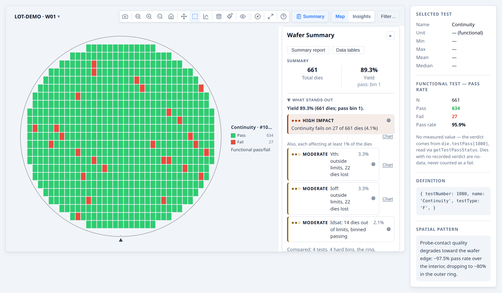

*Each die coloured by the pass or fail the tester recorded for one test, to show where a test failed, whether or not it has a measured value.*

**Why it is useful.** Some tests have no measured value at all: a continuity check, a scan chain, any go/no-go test. Their only result is a recorded pass or fail, and this map is how they are seen on the wafer. It is also the tester's own word for a parametric test that carries one.

**How to read it.** Each die is in the pass colour or the fail colour by the verdict the tester recorded for the chosen test, with a Pass/Fail legend giving the die count of each. Choosing a go/no-go test switches the map to this display on its own, since there is no gradient to fall back on.

**Notes.**

- **A die with no recorded verdict is no data, not a fail.** It is grey and is counted in neither colour.
- **A parametric test with recorded verdicts offers it as well**, in the **Overlays** menu as **Test pass/fail**, as an alternative to the [limit pass/fail map](#limit-passfail-map). The two can disagree, and the map shows the tester's side.

**Where to find it.** Choose a go/no-go test in **Plot mode**; for a parametric test, switch on **Test pass/fail** in the **Overlays** menu. **→ [Demo: Test values](examples/test-values.html)**

**See also.** [Limit pass/fail map](#limit-passfail-map), [Test value map](#test-value-map), [Pass rate by test](#pass-rate-by-test).

### PAT verdict map

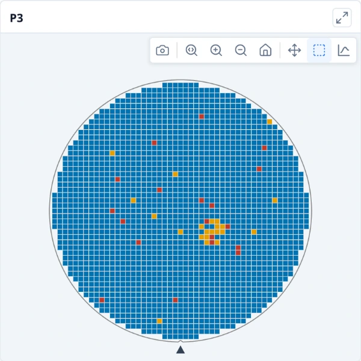

*Each die coloured by its part average testing verdict (within the limits, an outlier or failing), on the map or on every wafer of a gallery, to show where the PAT outliers sit.*

**Why it is useful.** The [PAT card](#part-average-testing-pat) says how many dies are outliers on each wafer and which tests drive it; the map says *where they are*. Outliers that cluster in one region point at a process or probe effect; scattered ones look like noise.

**How to read it.** Each die is coloured by its verdict: *within PAT limits* in blue, *PAT outlier* in amber, *fails* (rejected by its bin or limits already, so not an outlier) in red. The legend counts each, and hovering a die shows its verdict beside its bin and measurements. A die no test judged has no verdict and is drawn as no data. In a gallery every wafer uses the same three colours, so the cards compare.

**Notes.**

- **The verdicts are those of the PAT card**, so with a filter on they are judged over the dies the filter keeps, like every other figure in Insights; the dies the filter drops are drawn dimmed and carry no verdict.
- **It is a plot mode, so the map keeps its own yield, bins and selection.** Switching to another mode shows the bins and values again.
- **It shows what PAT would have flagged, not the screening itself**; the notes on the [PAT card](#part-average-testing-pat) apply.

**Where to find it.** Choose **PAT verdict** in the **Plot mode** menu of a map or a gallery; it is offered when a test has both limits and a wafer has enough dies to set PAT limits from. **Map the verdicts** on the PAT card, in **Insights ▸ Overview**, goes back to the maps in that mode.

**See also.** [Part average testing (PAT)](#part-average-testing-pat), [Bin map](#bin-map), [Test value map](#test-value-map).

### Die attribute map

*Each die coloured by an attribute the data carries (a test site, a probe step, a zone), to show whether a pattern follows it.*

**Why it is useful.** A pattern does not always follow the test results: it can follow where a die was tested, which probe step it was, which part of the wafer or which project it belongs to. Colouring by that attribute shows at a glance whether the failures line up with it.

**How to read it.** Each value of the attribute has its own colour, and the legend lists the values with their counts. Click a swatch to dim every other value. A die with no value for the attribute is drawn as no data, not as a category of its own. In a gallery a value has one colour on every card, so cards compare.

**Notes.**

- **The attribute has to come with the dies.** It is a per-die field your application supplies (`die.metadata`) and names with `metadataFields`; the map offers only the attributes the loaded data carries.
- **It can sit beside bins and test values.** A die can have an attribute and a bin; the attribute map colours by the attribute and leaves the bins as they are.
- **Many values mean many colours.** An attribute with dozens of values is better read through the legend and by highlighting one value at a time.

**Where to find it.** **Plot mode** on a map or a gallery's toolbar lists the attributes the data carries in its own section. **→ [Demo: Metadata plot mode](examples/metadata-mode.html)**

**See also.** [Bin map](#bin-map).

### Stacked map

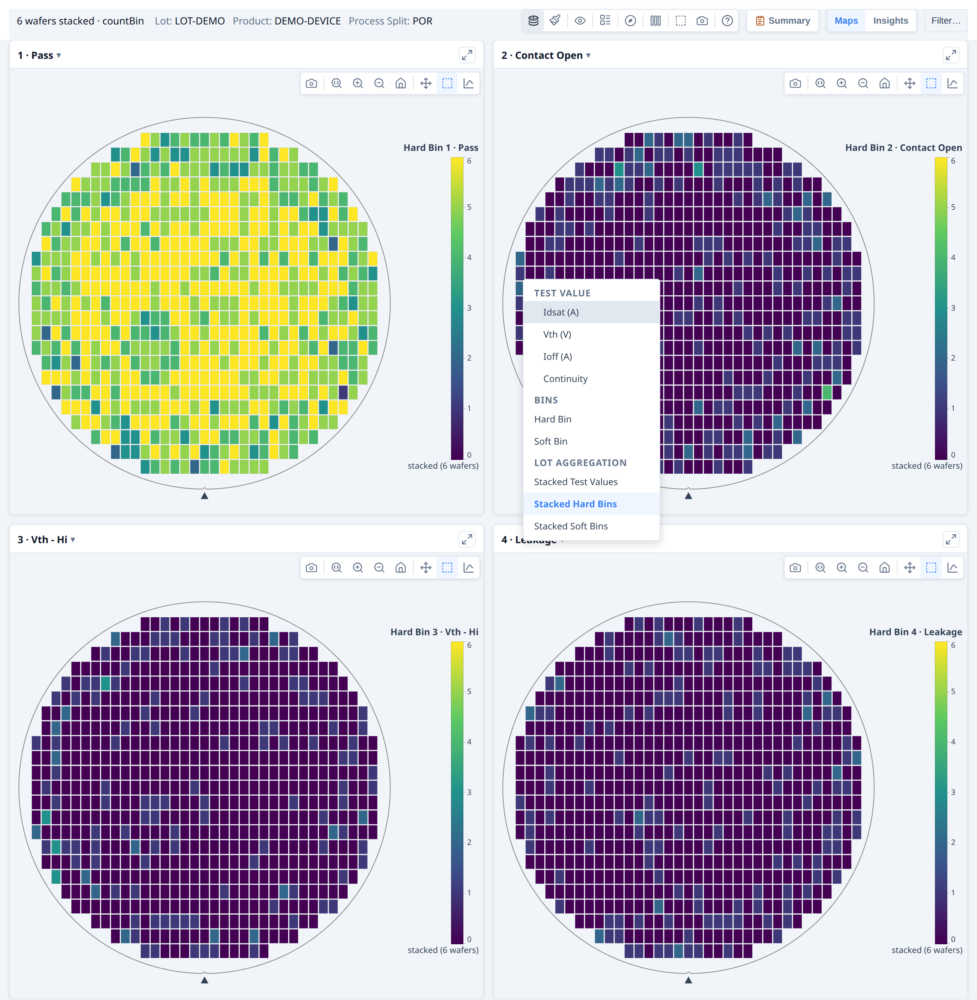

*The wafers of a lot laid over one another die by die: how often a bin occurs, or a value’s mean, median or spread at each position, to show what repeats from wafer to wafer.*

**Why it is useful.** One wafer's pattern can be chance; a pattern that lands on the same die positions across many wafers is not. Stacking lays the wafers of a lot over one another, so a mask defect, a probe-card pin or a reticle-position problem stands out and the wafer-to-wafer scatter averages away.

**How to read it.** In **Stacked hard bins** (or soft bins) there is one map per bin, each die position coloured by how many wafers had that bin there. In **Stacked test values** each position is an aggregate of the test across the wafers, chosen with the **Aggregation method** button: mean, median, standard deviation, minimum, maximum or the number of wafers with a value. The map says how many wafers were stacked and by which method ("3 wafers · mean"), so it is never taken for one wafer. With a standard deviation, a bright position is one where wafers disagree; with a mean, one where they agree on a high value.

**Notes.**

- **Wafers must be comparable to be stacked.** Wafers judged by different pass bins, or built with different ring counts, are not stacked, because there is no one verdict or ring to stack by.
- **Only dies with a position are stacked**, and a wafer the page filter drops whole is left out.
- **A value stack counts no bins.** A stacked map is never one wafer's figures: the header says how many wafers it holds.
- **A pattern needs enough wafers.** Three wafers can still agree by chance; the more wafers, the more a repeated position means.

**Where to find it.** In a gallery, **Plot mode** always offers the stacked modes. A single map offers them when it was built from a lot stack.

**See also.** [Difference map](#difference-map), [Reticle cell yield](#reticle-cell-yield).

### Difference map

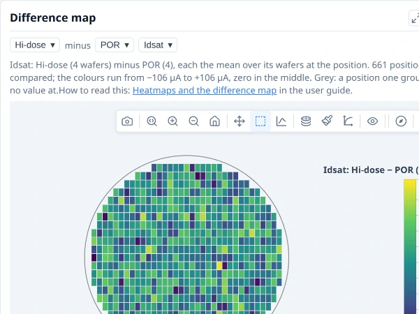

*One group’s wafer map less another’s, die position by die position, to show where on the wafer they differ.*

**Why it is useful.** The comparison table can say that two groups differ; the difference map says *where on the wafer*. An edge ring, a centre spot or a one-sided shift points at different causes, and none of them is visible in a table of means.

**How to read it.** With **Group by** on, choose two groups and a test (or yield). Each group's value at a die position is its mean over the group's wafers there (for yield, the share of them passing), as its stacked map would show it. The map shows the first group less the second at every position, on the value gradient and symmetric about zero, so the middle colour is no difference. A position that either group lacks is grey. It is drawn on the first wafer's geometry and orientation, so a die is where it is on every other map.

**Notes.**

- **It shows where, not whether.** A pattern on it says where the two processes differ on the wafer, not that the difference is significant; the [comparison by group](#comparison-by-group) judges that, with each wafer counted once.
- **A group of one wafer is one wafer's noise.** With few wafers in a group, a pattern may be that wafer's own.
- **Both groups need a value at a position** for it to be drawn.

**Where to find it.** **Insights ▸ Distributions**, at the foot, once **Group by** is on.

**See also.** [Stacked map](#stacked-map), [Comparison by group](#comparison-by-group).

---

## Yield and bins

### Yield by wafer

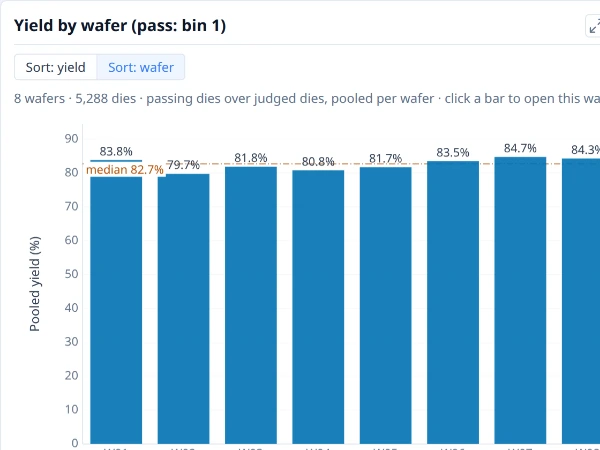

*Yield of each wafer or group: passing dies as a share of judged dies, with partial and edge-excluded dies left out. The line is the median bar.*

**Why it is useful.** It answers "which wafers are different?" before any other question: the wafer that fell away, the pair that sit apart, the drift down the cassette. It is also where a split experiment first shows: with **Group by** on, one bar per group says whether the groups differ in yield at all.

**How to read it.** Each bar is one wafer's yield, passing dies over judged dies. The pass bins are named in the card's title, so the yield says what it counts. The value is written at the end of the bar and the line is the median of the bars, so a bar far from the line is the wafer to open. Sort by yield to rank them or by wafer ID to see the cassette order. Click a bar to open that wafer's map; right-click it to chart that wafer alone. With Group by on, each bar is a group, pooled as passing dies over judged dies; click a group's bar to see its wafers and **Back** to return, or choose **Group, then wafer** to see every group's wafers inside it at once.

**Notes.**

- **A group's yield is pooled, not an average of its wafers.** A big wafer weighs more in a group than a small one. The **Mean per-wafer yield** tile above the charts is the other way: an unweighted mean of each wafer's own yield. The two differ when wafers have different numbers of dies, and the card and the tile say which they are.
- **Judged dies, not all dies.** Partial dies, edge-excluded dies and dies a filter drops are left out of both the passing and the judged count. A wafer with no bin data has no yield to draw.
- **Each wafer is judged by its own pass bins.** Wafers from different programs can have different ones; the title names them when they agree.
- **Yield says how much was lost, not where.** Follow a low bar to its map, the ring and quadrant yield charts, or the bin pareto.

**Where to find it.** **Insights ▸ Overview**, first card. To build it yourself, choose **+ New plot** on **My plots** and set **Chart type** to Bar, **Categories (X axis)** to Wafer and **Values (Y axis)** to Yield. Put a wafer attribute (a split, a lot) on the categories instead of the wafer to compare groups.

<details markdown="1">
<summary>The plot as JSON</summary>

See [Using a plot's JSON](#using-a-plots-json).

```json
{ "chart": "bar", "fields": { "x": { "builtin": "wafer" }, "y": { "builtin": "yield" } } }
```

</details>

**See also.** [Bin pareto](#bin-pareto), [What divides yield](#what-divides-yield). The [user guide](user-guide.md#8-insights-tab) describes the Overview tab.

### Bin pareto

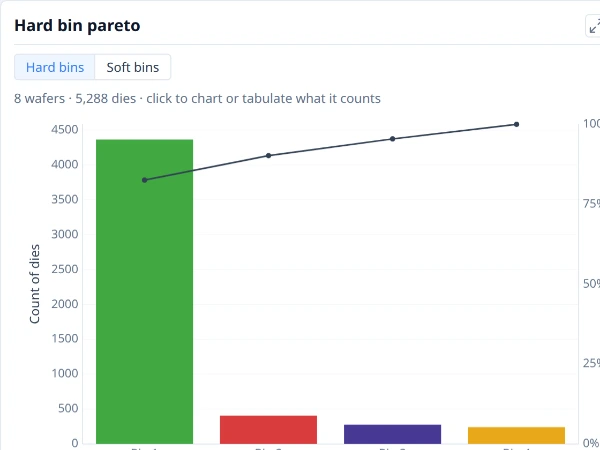

*Dies in each bin, largest first, so the bins that cost the most yield lead. Shown alone, the line is the running share of all dies.*

**Why it is useful.** Yield is the loss in one number; the pareto splits it by bin, so the failing bins that cost the most dies lead and the few that account for most of the loss are plain. It is the usual first answer to "what do we fix first?".

**How to read it.** Bars run from the bin with the most dies to the one with the fewest, named from the bin definitions where the data carries them. The passing bin is usually the first and tallest; the failing bins follow. Shown alone, the line is the running share of all dies. A toggle switches between hard and soft bins. With **Group by** on there is a bar per group in each bin, as each group's share of its own dies so groups of different sizes compare, or as counts; **Bin mix** turns it round, a bar per group split into its bins. Soft bins keep the fifteen largest, and a note says how many were left out. Click a bar to chart or tabulate the dies in it.

**Notes.**

- **The passing bin is in the chart.** The cumulative line is a share of all dies, so it starts high; read the losses from the second bar.
- **Counts are pooled over the wafers shown.** Compare wafers or groups of different sizes by share.
- **Hard and soft bins are different charts** and rarely the same dies.

**Where to find it.** **Insights ▸ Overview**. To build your own, see [Pareto](#pareto).

**See also.** [Bin map](#bin-map), [Pareto](#pareto).

### Pass rate by test

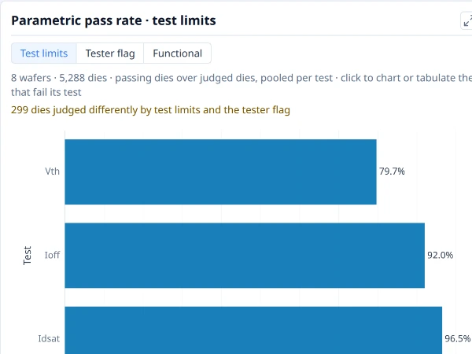

*The share of judged dies that pass each test, lowest first, so the tests that fail the most dies lead.*

**Why it is useful.** A die can fail for many reasons; this ranks the tests by how many dies each fails, so the test that costs the most is at the top. With **Group by** on, it also shows whether a test fails more in one split than another.

**How to read it.** Tests run down the left, worst first, each with its pass rate at the end of its bar. With more than 25 tests the worst 25 are drawn (choose **All tests** for the rest), and with Group by on **Grid** shows the worst 25 as a grid of test by group, so a test that fails in one group stands out as a coloured cell. Up to three ways of judging are offered, whichever the data supports: **Test limits** (the measured value against the test's limits), **Tester flag** (the pass or fail the tester itself recorded, which a parametric test carries whether or not its limits were exported) and **Functional** (tests that are only pass or fail). Click a test's bar to chart or tabulate the dies that fail it.

**Notes.**

- **The two parametric judgements can differ.** Guard bands and dynamic limits are two ways it happens, so the card says how many dies the two judged differently instead of choosing one for you.
- **It is a test's pass rate, not the yield.** A die's yield depends on its bin and on every test; this is the share of the dies a single test judges that pass it.
- **A test judges only the dies it has a result for**, so two tests can be judging different numbers of dies.
- **With nothing to judge** (no limits and no recorded verdicts) the card is left out.

**Where to find it.** **Insights ▸ Overview**. As a plot: a [bar chart](#bar-chart) with **Read as** set to Pass rates.

**See also.** [Process capability](#process-capability), [Bin pareto](#bin-pareto).

### Ring yield

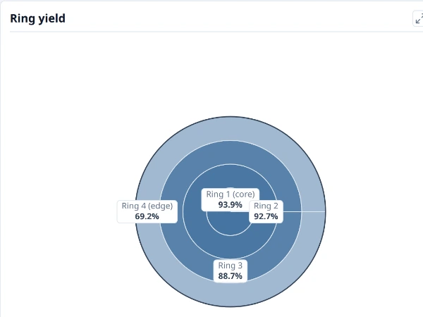

*Yield of each ring, from the wafer centre to its edge, to show a radial pattern.*

**Why it is useful.** Many process problems are radial: edge roll-off, a bowed centre, a ring from a spin-on step. Yield by ring shows whether the loss sits at the centre, the edge or between.

**How to read it.** The wafer is drawn as concentric rings, each labelled in place with its yield. Ring 1 is the centre and the last ring the edge; the number of rings is the wafer's own (four by default). Hover a ring for its dies and click it to chart or tabulate them. A bright centre falling away to a dark edge is the classic edge loss.

**Notes.**

- **Rings are the same everywhere.** The rings here are the ones the **Ring boundaries** overlay draws and the findings use, so a finding about "Ring 4" is this ring.
- **Judged dies only.** Partial dies, edge-excluded dies and dies a filter drops are not in a ring's yield.
- **Wafers built with different ring counts are named by a warning**, and the lot's ring figures follow the first wafer's rings.

**Where to find it.** **Insights ▸ Overview**. As a plot, put **Ring** on the categories of a [bar chart](#bar-chart) of yield.

**See also.** [Ring yield by wafer](#ring-yield-by-wafer), [Quadrant yield](#quadrant-yield), [Bin map](#bin-map).

### Ring yield by wafer

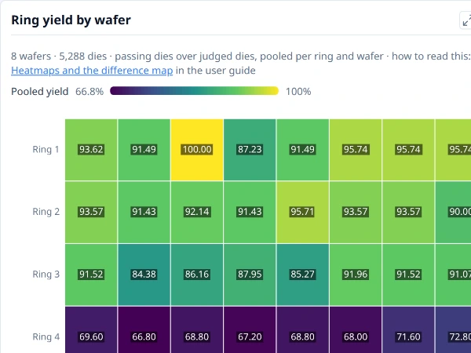

*Yield of each ring on each wafer (or group), as a colour, to show whether a radial pattern is on every wafer or on one.*

**Why it is useful.** The [ring yield](#ring-yield) diagram pools every wafer, so an edge loss on one wafer and a mild edge loss on all of them look alike. Laid out wafer by wafer, a dark cell in one column is a wafer problem and a dark row across every column is a process one.

**How to read it.** Each row is a ring (Ring 1 the centre) and each column a wafer, or a group when **Group by** is on. A cell's colour is the yield of that ring on that wafer, pooled over its judged dies. Hover a cell for its figure and its dies.

**Notes.**

- **Judged dies only**, as in every yield here, each wafer judged by its own pass bins.
- **Only for two wafers or more**; one wafer has the ring diagram alone.

**Where to find it.** **Insights ▸ Overview**, beside the ring yield. To build your own, choose **+ New plot** on **My plots**, set **Chart type** to Heatmap, **Columns (X axis)** to Wafer, **Rows** to Ring and **Values (Y axis)** to Yield.

**See also.** [Ring yield](#ring-yield), [Heatmap](#heatmap).

### Quadrant yield

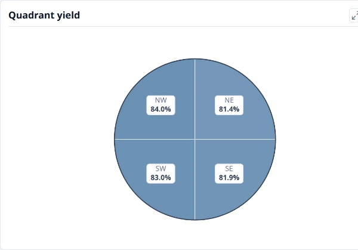

*Yield of each quarter of the wafer, to show a one-sided pattern.*

**Why it is useful.** A one-sided loss (a tilted probe card, a gradient across the wafer, a one-sided etch) has the same total yield as a symmetric one. Splitting the wafer into quarters shows whether one side is worse.

**How to read it.** The wafer is drawn as four quarters (NE, NW, SE, SW), each labelled in place with its yield. Hover a quarter for its dies and click it to chart or tabulate them. Quarters that agree point away from a one-sided cause; one that stands apart points to it.

**Notes.**

- **A radial pattern shows in all four quarters.** Read it together with the [ring yield](#ring-yield); a loss can be radial and one-sided at once.
- **Four quarters are coarse.** A diagonal or narrow sector shows better in the findings, which also scan 16 compass sectors.
- **Judged dies only**, as in every yield here.

**Where to find it.** **Insights ▸ Overview**. As a plot, put **Quadrant** on the categories of a [bar chart](#bar-chart) of yield.

**See also.** [Quadrant yield by wafer](#quadrant-yield-by-wafer), [Ring yield](#ring-yield), [Bin map](#bin-map).

### Quadrant yield by wafer

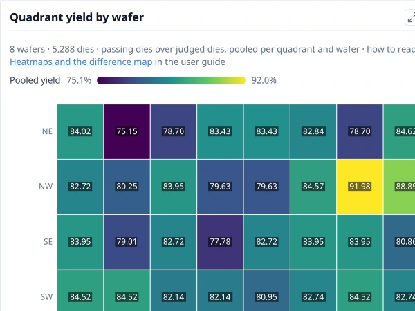

*Yield of each quarter of the wafer on each wafer (or group), as a colour, to show whether a one-sided pattern is on every wafer or on one.*

**Why it is useful.** The [quadrant yield](#quadrant-yield) diagram pools every wafer, so a quarter that is low on all of them (a tilted probe card, a gradient in the process) looks like one that is very low on a single wafer. Laid out wafer by wafer, a dark row across every column is the first and a dark cell in one column the second.

**How to read it.** Each row is a quarter (NE, NW, SE, SW) and each column a wafer, or a group when **Group by** is on. A cell's colour is the yield of that quarter on that wafer, pooled over its judged dies. Hover a cell for its figure and its dies.

**Notes.**

- **Judged dies only**, each wafer judged by its own pass bins.
- **Only for two wafers or more**; one wafer has the quadrant diagram alone.

**Where to find it.** **Insights ▸ Overview**, beside the quadrant yield. To build your own, choose **+ New plot** on **My plots**, set **Chart type** to Heatmap, **Columns (X axis)** to Wafer, **Rows** to Quadrant and **Values (Y axis)** to Yield.

**See also.** [Quadrant yield](#quadrant-yield), [Ring yield by wafer](#ring-yield-by-wafer), [Heatmap](#heatmap).

### Reticle cell yield

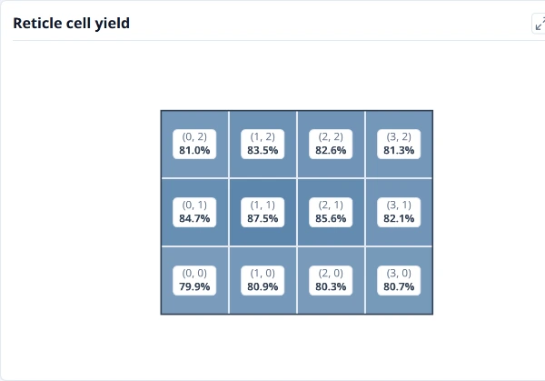

*Yield of each position in the reticle, pooled over every shot on every wafer. A cell low everywhere points at the mask rather than the wafer.*

**Why it is useful.** A defect in the mask repeats in every field, at the same position, on every wafer. Yield by position in the field shows it where a wafer map, with its thousands of dies, does not.

**How to read it.** The stepper field is drawn as its cells, with row 0 at the bottom, each filled by the yield of that position pooled over every field on every wafer and labelled with it. Hover a cell for its dies and click it to chart or tabulate them. A cell that is low in all of them points at the mask rather than the wafer.

**Notes.**

- **It needs the reticle.** The card appears only when the data states the field size (a reticle configuration); without one there are no cells to draw.
- **It pools the lot.** One cell is every die at that position across the wafers shown, so a single bad wafer moves it only a little.
- **Judged dies only.**

**Where to find it.** **Insights ▸ Overview**. As a plot, put **Reticle cell** on the categories of a [bar chart](#bar-chart) of yield.

**See also.** [Stacked map](#stacked-map), [Ring yield](#ring-yield).

---

## Values and distributions

### Test value distribution

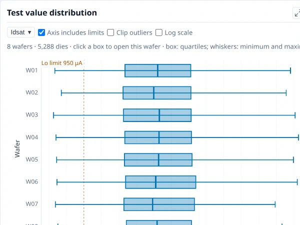

*How one test’s values spread on each wafer or group: the box holds the middle half of the dies, the line inside it is the median, and the whiskers reach the lowest and highest values.*

**Why it is useful.** It is the [box plot](#box-plot) for the test you are looking at, one box per wafer down the left (or one per group with Group by on), so a wafer that shifted, widened or grew a tail stands out beside the rest.

**How to read it.** Read it as a box plot: the box holds the middle half of the dies, the line inside it is the median and the whiskers reach the lowest and highest values. Click a group's box to see its wafers and **Back** to return, or choose **Group, then wafer** to draw every group's wafers inside it, coloured by group. Pick the test at the top. **Axis includes limits** widens the axis to the test's limits, **Clip outliers** narrows it to a robust range, and you choose which limits to draw. A change here reaches the histogram and the trend beside it.

**Notes.**

- **The same notes as the box plot apply**: the count is dies, not wafers, and one outlier sets a whisker. Whether groups differ is for the [comparison](#comparison-by-group).
- **It is a plot.** **Edit as plot** in the card's ⋯ menu opens it as one of your own.

**Where to find it.** **Insights ▸ Distributions**.

**See also.** [Box plot](#box-plot), [Value histogram](#value-histogram).

### Value histogram

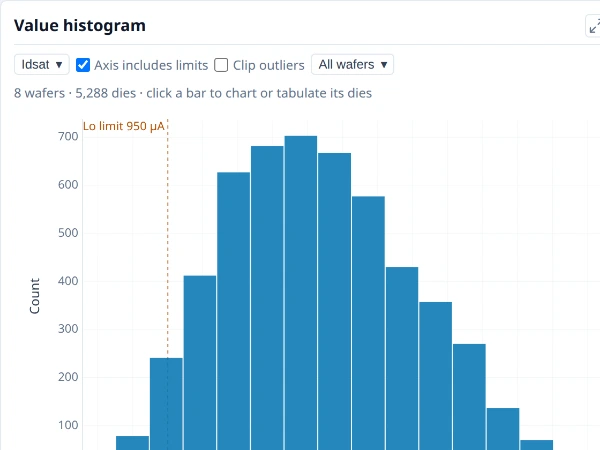

*How one test’s values are distributed: the number of dies in each value range, with the test’s limits marked.*

**Why it is useful.** A mean and a spread hide the shape. A histogram shows a second population, a long tail, a clamp at a rail or a distribution pushed against a limit, all of which change what to do about a test.

**How to read it.** Bars count the dies in each range of values, and the test's limits are marked. Read the shape: one hump, two humps (two populations, often two splits), a tail on one side, a spike at one value. With **Group by** on there is one series per group, each drawn as a share of its own dies so groups of different sizes compare (choose **Counts** for the number of dies), and a click on a group in the legend shows only that group in this plot. Choose all wafers or one at a time, and pick the test at the top.

**Notes.**

- **Pooling can make two humps.** A histogram of every die in a lot mixes its splits and wafers; use Group by, or colour a plot by the split, to see whether one hump is really two groups.
- **A limit shows where the values lie, not what the limit should be.** For "what if the limit moved" use a plot with what-if limits (see the [histogram](#histogram)).
- **It is a plot.** **Edit as plot** opens it as one of your own, and the right-click [histogram of the dies picked](#histogram-of-the-dies-picked) is the same chart for a selection.

**Where to find it.** **Insights ▸ Distributions**.

**See also.** [Histogram](#histogram), [Probability plot](#probability-plot), [Test value map](#test-value-map).

### Histogram of the dies picked

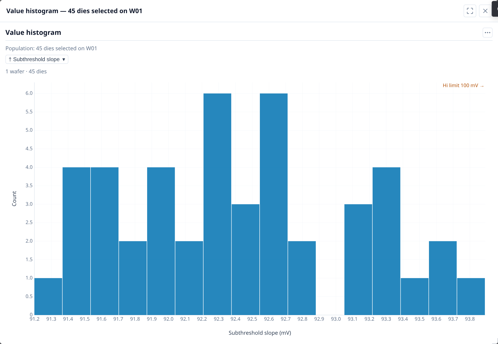

*How one test’s values are distributed over the dies picked: the number of dies in each value range, with the test’s limits marked.*

**Why it is useful.** Most questions about a wafer are about some of its dies: the cluster, the edge, one bin, one wafer out of a lot. Right-click them and ask how a test behaves *there*, not across the whole wafer.

**How to read it.** It is the [value histogram](#value-histogram) drawn from exactly the dies you picked. Its title and the line above the plot state the population ("21 dies selected on W01"), so it cannot be mistaken for the whole wafer. The same menu offers process capability, your saved plots and sweeps, and the Dies and Test statistics tables over those dies.

**Notes.**

- **It is a snapshot.** Changing the selection afterwards does not change a chart that is already open.
- **Partial and edge-excluded dies are left out**, as everywhere else, and the chart says how many that was.
- **A chart that cannot be drawn stays in the menu, greyed, with the reason**, for example when none of the picked dies has values for the test.

**Where to find it.** Right-click a selection on a map or a card (or a wafer's card), or press the Menu key or Shift+F10, or use the toolbar's **Chart** button. **→ [Demo: Charting a selection](examples/drilldown.html)**

**See also.** [Value histogram](#value-histogram).

### Box plot

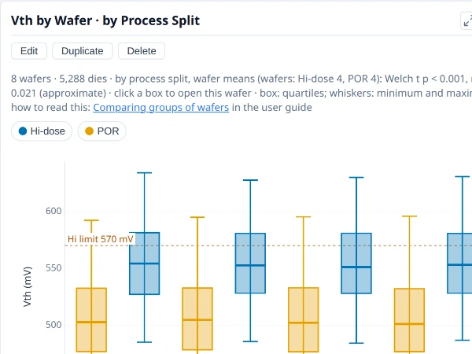

*How a value spreads in each category: the box holds the middle half, the line inside it is the median, and the whiskers reach the lowest and highest values.*

**Why it is useful.** One mean per wafer hides what a test is doing. A box shows the centre, the spread and the extremes of every wafer side by side, so a wafer that shifted, one that widened and one with a tail show up as different shapes. Boxes of the same test across a lot are how a process shift, a probe problem or a split effect is first seen in the values rather than in the bins.

**How to read it.** The box runs from the first to the third quartile, so half the dies lie inside it, and the line inside is the median. The whiskers reach the lowest and highest value, not a statistical fence: a single outlying die stretches a whisker. A box far from its neighbours is a shifted wafer; a tall box is a wide distribution; a median off-centre in its box is skew. Colour carries a second field (a process split, say), so two groups interleaved across the wafers read at once.

**Notes.**

- **The count is dies, not wafers.** Thousands of dies make a box look certain, but dies on one wafer are not independent: a shift between two groups of wafers is judged on the wafers, as the [comparison by group](user-guide.md#102-comparing-groups-of-wafers) does. Use a box to see a difference and the comparison to decide whether it is one.
- **One outlier sets a whisker.** Switch on **Clip outliers** to draw the bulk of the data at a readable scale; the chart says how many values lie outside the clipped axis, and they are still counted.
- **A box of a few dies is not a distribution.** With only a handful of values the quartiles move with each die.
- **Units and limits belong to one test.** Boxes of several tests share an axis only when they are rescaled (a plot's **Rescale values** option), which hides the units; the chart states how it rescaled them under the plot.

**Where to find it.** **Insights ▸ Distributions** draws *Test value distribution*, a box per wafer (or per group with Group by on) for the test you pick. To build your own, choose **+ New plot** on **My plots**, set **Chart type** to Box, **Categories (X axis)** to Wafer (or a wafer attribute), **Values (Y axis)** to a test, and **Colour** to a field such as the process split.

<details markdown="1">
<summary>The plot as JSON</summary>

See [Using a plot's JSON](#using-a-plots-json).

```json
{ "chart": "box", "fields": { "x": { "builtin": "wafer" }, "y": { "test": 1060, "name": "Vth" }, "color": { "meta": "processSplit" } } }
```

</details>

**See also.** [Test value distribution](#test-value-distribution), [Nested categories](#nested-categories), [Probability plot](#probability-plot). [Comparing groups of wafers](user-guide.md#102-comparing-groups-of-wafers) explains why the wafer is the unit.

### Histogram

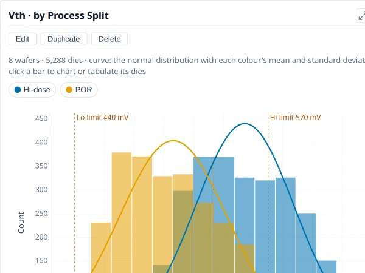

*How a value is distributed: the number of dies or wafers in each value range.*

**Why it is useful.** The same view as the Insights histogram, for any value you choose: a test, a die's position, a wafer's yield. Colour it by a split and the two groups' shapes sit on one axis.

**How to read it.** Bars count dies (or wafers) in each range of values. **Bars as** *Shares* draws each colour's bars as a percentage of its own values, so a split of three wafers and one of thirty compare by shape. **Normal curve** overlays each colour's normal distribution at its mean and standard deviation, scaled to its bars. **What-if limits** draw a proposed low and high limit and state the test's pass rate now and under them, with how many dies change.

**Notes.**

- **The normal curve is left off a log axis**, where a normal distribution is not the shape the bars would follow.
- **What-if limits give the test's pass rate, not the yield.** The yield depends on every test and bin; treat the figure as an aid to a limit discussion.
- **Colour and panels split what is pooled.** A histogram of every die in a lot can show two humps that are really two splits.

**Where to find it.** On **My plots**, choose **+ New plot** and set **Chart type** to Histogram and **Values** to a test; **Colour** and **Panels** split it, and **Bars as**, **Normal curve** and **What-if limits** are further down.

<details markdown="1">
<summary>The plot as JSON</summary>

See [Using a plot's JSON](#using-a-plots-json).

```json
{ "chart": "histogram", "fields": { "y": { "test": 1060, "name": "Vth" }, "color": { "meta": "processSplit" } }, "normalCurve": true }
```

</details>

**See also.** [Value histogram](#value-histogram), [Probability plot](#probability-plot), [Box plot](#box-plot).

### Probability plot

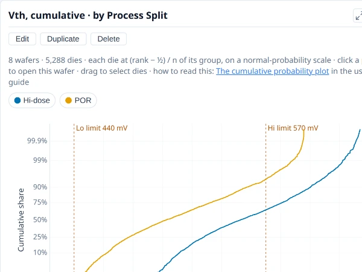

*The share of values at or below each value, a curve per colour, so whole distributions compare, tails included.*

**Why it is useful.** A histogram needs a choice of bin width, and overlaying several groups makes it unreadable. A probability plot draws each group's whole distribution as a curve, tails included, so many groups compare at once and a shifted or wider group is plain.

**How to read it.** Each group's values are sorted and the k-th smallest of n is drawn at height (k + ½) ÷ n, so the curve is the share of values at or below each value. On the default **normal** axis the vertical scale is stretched so that values following a bell curve fall on a straight line: the middle is the median and the steepness is the spread. Read it by comparison: a curve moved sideways is a shift in the mean, a flatter one a wider spread, a bend or a step a second population, and points off the ends of the line outliers or heavy tails. Choose **Linear** under **Share axis** for the plain 0 to 100% axis.

**Notes.**

- **Large groups are drawn from a sample.** A curve of many dies draws a sample of 1,500 points with both tails kept in full, and a drag still takes every die.
- **Hover a point** for its die, its rank in its group and where that rank is plotted; click it to open its wafer, or drag a box to send the dies inside to the drilldown menu.
- **What-if limits** work as on the [histogram](#histogram).

**Where to find it.** On **My plots**, choose **+ New plot** and set **Chart type** to Probability and **Values (X axis)** to a test; **Colour** gives a curve per group.

<details markdown="1">
<summary>The plot as JSON</summary>

See [Using a plot's JSON](#using-a-plots-json).

```json
{ "chart": "probability", "fields": { "y": { "test": 1060, "name": "Vth" }, "color": { "meta": "processSplit" } } }
```

</details>

**See also.** [Histogram](#histogram), [Box plot](#box-plot).

---

## Relationships

### Test scatter

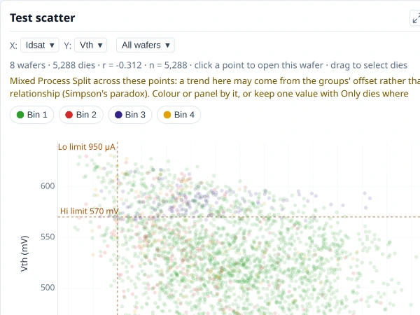

*One test against another, a point per die, to show whether the two move together. r is the correlation coefficient and n the number of dies.*

**Why it is useful.** A wafer map shows one measurement at a time. A scatter shows whether two move together (two tests driven by the same process step, a leakage that tracks a threshold), which tests can then share a cause or a fix.

**How to read it.** A point is a die: its X test against its Y test, with the test limits drawn on the axes. The card prints **r**, the correlation coefficient of the points drawn, and **n**, how many there are, above the chart. A cloud tilting up to the right is a positive relationship, down to the right a negative one, a round cloud none. Click a point to open its wafer; drag a rectangle over the scatter to chart and tabulate the dies inside it. With **Group by** on, a fitted line per group shows whether the relationship is the same in each. Pick the two tests at the top.

**Notes.**

- **Dies on one wafer are not independent**, so a large n makes r look more certain than it is.
- **Pooled groups can invent a trend.** When the points pool several values of a split or lot that neither the colour nor the panels divide by, a trend across them may be the groups' offset (Simpson's paradox), and the card warns. Colour by the split, or use panels, to see the relationship inside each group.
- **A correlation is not a cause.** Two tests can move together because the same step moves both.

**Where to find it.** **Insights ▸ Correlation**, below the matrix, or from a cell of the [correlation matrix](#test-correlation-matrix). It is a plot: **Edit as plot** opens it as one of your own.

**See also.** [Test correlation matrix](#test-correlation-matrix), [Scatter plot](#scatter-plot).

### Test correlation matrix

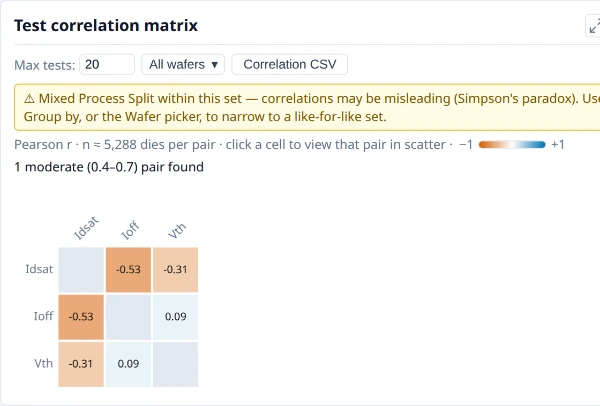

*The correlation of every pair of tests. A strong colour means two tests move together; click a cell to show the pair in the scatter.*

**Why it is useful.** With dozens of tests, you cannot scatter every pair. The matrix shows all the pairs at once, so the few that move together are the ones to open.

**How to read it.** Each cell is the Pearson correlation (r) of two tests over the dies, with the number of pairs it rests on, coloured from strong negative to strong positive. A strong colour means two tests move together or against each other. The card counts the pairs by strength ("1 moderate (0.4 to 0.7) pair found") and a **Max tests** box limits how many tests it draws. Click a cell to show that pair in the [scatter](#test-scatter).

**Notes.**

- **Pooled groups can mislead.** When the dies pool several values of a split, lot or other field, the card warns that correlations may be misleading (Simpson's paradox); use **Group by**, or the **Wafer** picker, to narrow to like-for-like.
- **With Group by on, Show decides the dies.** Pick one group in **Show** to see the correlations inside it; with **All groups** the matrix pools every wafer, and the card warns when that mixes groups.
- **Dies on one wafer are not independent**, so a pair's n overstates how well it is known.
- **Correlation says two tests move together, not why.**

**Where to find it.** **Insights ▸ Correlation**.

**See also.** [Test scatter](#test-scatter), [Heatmap](#heatmap).

### Scatter plot

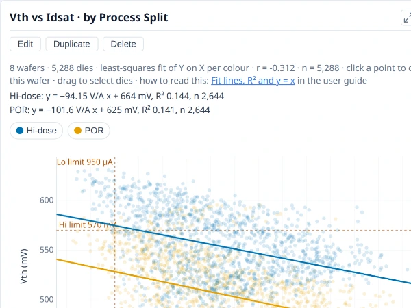

*One field against another, a point per die or per wafer, to show whether they move together.*

**Why it is useful.** The Insights scatter for any two values you choose: a test against a position, a wafer's yield against a lot field, a test against a measured value drawn on a gradient. Coloured by a split, it shows whether the relationship is the same in each group.

**How to read it.** A point is a die, or a wafer when both fields are wafer figures. **Fit line** draws one line per colour, with its equation, R² and number of points above the chart. *Least squares* is the usual regression of Y on X: use it when X is the cause or the controlled quantity. *Orthogonal* minimises the distance at right angles to the line: use it when X and Y are two measurements of the same quantity (one test on two testers), where least squares tilts the line towards flat. **y = x line** draws the line of agreement and is offered only when X and Y share a unit.

**Notes.**

- **R² is the share of Y's variation a straight line in X accounts for.** It says nothing about whether a line is the right shape; look at the points.
- **Colour can be a measured value**, on a gradient with a colour bar under the title stating its range.
- **Pooling can hide or invent a trend** when a split is not divided by colour or panels, as for the [test scatter](#test-scatter).

**Where to find it.** On **My plots**, choose **+ New plot**, set **Chart type** to Scatter and the **X axis** and **Y axis**; **Fit line** is below.

<details markdown="1">
<summary>The plot as JSON</summary>

See [Using a plot's JSON](#using-a-plots-json).

```json
{ "chart": "scatter", "fields": { "x": { "test": 1050, "name": "Idsat" }, "y": { "test": 1060, "name": "Vth" }, "color": { "meta": "processSplit" } }, "fit": "linear" }
```

</details>

**See also.** [Test scatter](#test-scatter), [Heatmap](#heatmap).

### Heatmap

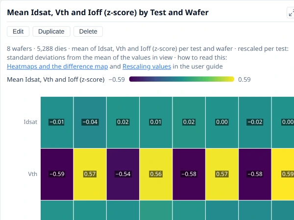

*A value for every pair of two categories, as a colour, to show where the two interact.*

**Why it is useful.** When two categories interact (tests by wafer, bins by split, rings by lot), a grid of colours shows where the interesting cells are faster than a pile of bars. With tests as the rows it is a quick read of which wafers move which tests.

**How to read it.** One row per value of one field and one column per value of another, each cell coloured by the value combined over its dies (a count when no value is chosen). The colour bar above spans the cells and a cell shows its value when it has room. Click a cell to chart or tabulate its dies. With several tests as the rows, they are rescaled so they can share the colours, and the cells then say how far from each test's own average a wafer is.

**Notes.**

- **A heatmap is a bar chart laid out as a grid**, so the same rules apply: yield is pooled, pass rates are shares of judged dies, and **Filter** works as on a bar.
- **A z-score is relative to the population in view**, so it changes when you narrow the wafers; rescaling to limits does not.
- **Colour differences are the only cue**, so read the numbers in the cells for exact values.

**Where to find it.** On **My plots**, choose **+ New plot**, set **Chart type** to Heatmap, **Columns (X axis)**, **Rows** and **Values (colour)**.

<details markdown="1">
<summary>The plot as JSON</summary>

See [Using a plot's JSON](#using-a-plots-json).

```json
{ "chart": "heatmap", "fields": { "x": { "builtin": "wafer" }, "y": { "tests": [1050, 1060, 1070], "names": { "1050": "Idsat", "1060": "Vth", "1070": "Ioff" } } }, "aggregate": "mean", "normalize": "zscore" }
```

</details>

**See also.** [Test correlation matrix](#test-correlation-matrix), [Difference map](#difference-map), [Bar chart](#bar-chart).

---

## Time, drift and control

### Wafer-to-wafer trend

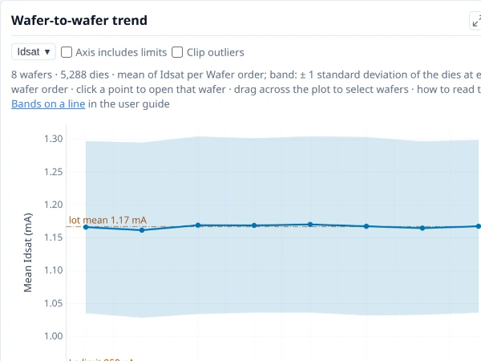

*Each wafer’s mean of one test in wafer order, with a band of one standard deviation either side, to show drift through the lot.*

**Why it is useful.** A lot is run in an order, and a slow drift across a cassette only reads in that order. The trend shows each wafer's mean in sequence, so a climb, a step or a sawtooth is visible.

**How to read it.** One point per wafer at its mean of the test, in the order the wafers were loaded, with a band of one standard deviation either side. A line marks the mean of all wafers (the "lot mean" when they all come from one lot), and the test's limits are drawn. Drag across the plot to pick a run of wafers.

**Notes.**

- **The order is the data's.** There is deliberately no sort control, because sorting would destroy the drift; it needs at least two wafers.
- **The control chart is one click away.** Choose **Control chart** (from three wafers) for each wafer's mean against control limits, with the points that break a rule marked; see the [control chart](#control-chart).
- **It is a plot.** **Edit as plot** opens it as one of your own.

**Where to find it.** **Insights ▸ Distributions**.

**See also.** [Control chart](#control-chart), [Line chart](#line-chart).

### Control chart

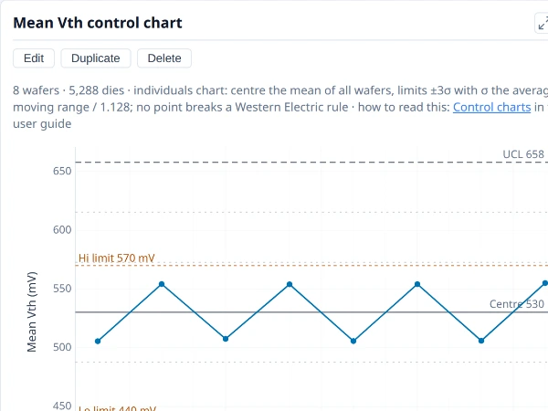

*One value per wafer in order against its centre line and control limits, with the points that break a Western Electric rule marked.*

**Why it is useful.** A lot is made in an order, and a process that is drifting or that jumped part-way through is invisible in a box plot, which has no order. A control chart keeps the order and states what the process normally does, so the wafer that is unusual *for this run* stands out, whether or not it is out of specification. It is the chart to ask "did something change?" with.

**How to read it.** The line through the middle is the centre (the mean) and the two outer lines are the control limits at three sigma either side. Sigma comes from the average difference between one wafer and the next, so it measures wafer-to-wafer noise, and a slow drift does not widen the limits it is judged against. A point is marked when it breaks one of four Western Electric rules, each at the point that completes it: one beyond three sigma; two of three beyond two sigma on the same side; four of five beyond one sigma on the same side; eight in a row on one side of the centre. A marked point means the pattern is unlikely if the process were stable.

**Notes.**

- **Where the limits come from.** The centre and the control limits are worked out from the wafers on the chart, so they say what this run normally does, and a point beyond them is unusual *for this run*. They are not read from any limit your team sets for the test, and the two answer different questions: a run can be steady and still outside a limit you use, or the reverse. Lines for the test's own limits, or any value you choose, can be added to the axis as reference lines; the capability chart compares the values with the test's limits directly.
- **A few marks are expected.** With many points a number of false flags is normal; one flag among fifty wafers is not a finding by itself.
- **Order is the whole point.** The wafers must be in the sequence they were run; a lot sorted by yield or ID has no meaningful trend. A chart of several lots or programs in one run mixes processes and widens the limits.
- **It needs a baseline.** **Limits from the first** sets the centre and sigma from earlier wafers and judges the later ones against them; it needs at least three points.

**Where to find it.** Choose **+ New plot** on **My plots**, set **Chart type** to Control, **Along (X axis)** to wafer order and **Values (Y axis)** to a test; **Limits from the first** is optional. The Overview's **Worth a look** draws one when it finds a trend across the wafers.

<details markdown="1">
<summary>The plot as JSON</summary>

See [Using a plot's JSON](#using-a-plots-json).

```json
{ "chart": "control", "fields": { "x": { "builtin": "waferOrder" }, "y": { "test": 1060, "name": "Vth" } } }
```

</details>

**See also.** [Wafer-to-wafer trend](#wafer-to-wafer-trend), [Line chart](#line-chart), [Capability goal plot](#capability-goal-plot). [Control charts](user-guide.md#107-control-charts) in the user guide gives the formulae.

### Line chart

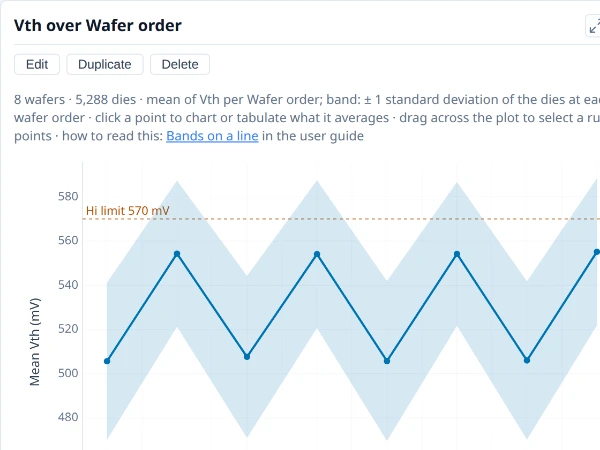

*A summary value in order along the X axis (wafer order, a test, a condition), to show a trend.*

**Why it is useful.** A summary value in order shows a trend: a test across wafers, a measurement across a condition. It is the plot behind the wafer-to-wafer trend, for any X and Y you choose.

**How to read it.** A line joins the combined value (mean, median or another, chosen with **Combine values by**) at each X. A **Band** shows the spread of the values combined at each X: *±1 SD* (mean plus and minus one standard deviation), *95% CI* (the range that would contain the true mean 95% of the time, from Student's t, so it narrows with more dies and says nothing about how spread out they are), *Quartiles* (Q1 to Q3) or *Range* (smallest to largest). Use SD or quartiles to see how much the values vary, the interval to see how well the mean is pinned down.

**Notes.**

- **A line implies an order.** It is meaningful where X is ordered (wafer order, a test order, a condition) and misleading across unordered categories; use a [bar chart](#bar-chart) there.
- **A mean can hide the shape.** Compare with the [box plot](#box-plot) of the same values.

**Where to find it.** On **My plots**, choose **+ New plot**, set **Chart type** to Line, the **X axis** and **Y axis**; **Band** and **Combine values by** are below.

<details markdown="1">
<summary>The plot as JSON</summary>

See [Using a plot's JSON](#using-a-plots-json).

```json
{ "chart": "line", "fields": { "x": { "builtin": "waferOrder" }, "y": { "test": 1060, "name": "Vth" }, "color": { "none": true } }, "aggregate": "mean", "spread": "sd" }
```

</details>

**See also.** [Control chart](#control-chart), [Sweep](#sweep), [Wafer-to-wafer trend](#wafer-to-wafer-trend).

### Sweep


*A measured value against a swept condition, a curve per series, to show how the part responds across the range.*

**Why it is useful.** A test program often measures one quantity at a series of conditions (supply voltage, gate voltage, bake time) and records each condition as its own test number. Read one test at a time, that is a row of unrelated distributions; read as a sweep it is a response curve, and a pair of sweeps (up and down, hot and cold) is a pair of curves the chart can measure against each other.

**How to read it.** Each line is the population median across the dies in scope, with a shaded band from the 10th to the 90th percentile, not a trace per die (a lot is thousands of dies and per-die traces would be a solid block of ink). The card measures the pair: where the curves cross, and how far apart they are, horizontally, at a given level (the width). A level of the curve opens the menu of what to open on the dies measured there.

**Notes.**

- **The band is the spread across the dies now in scope**, so it changes with Group by, the wafer picker and any filter.
- **A sweep is a plot.** It is kept, duplicated, deleted, exported and imported like any other, and is offered in the right-click menu's **Plots** section.
- **A sweep of tests this lot lacks is kept, and greyed**, with the reason.

**Where to find it.** On **My plots**, **+ New sweep** starts one on the first tests of the lot and **Edit** opens the sweep editor beside a live copy. **→ [Demo: Parametric sweeps](examples/sweeps.html)**; the user guide's [Sweep cards](user-guide.md#sweep-cards) has the detail.

**See also.** [Line chart](#line-chart).

---

## Capability and limits

### Process capability

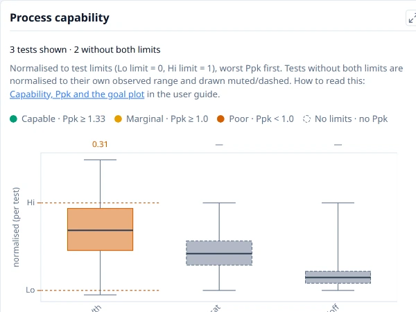

*Every test with limits on one scale, the low limit at 0 and the high limit at 1, sorted lowest Ppk first, so the tests closest to their limits lead.*

**Why it is useful.** Tests are in different units, so their spreads cannot be compared as measured. Putting every test with limits on one scale, relative to its own limits, shows which tests have the least room, and so which to look at first.

**How to read it.** Each test is a box on a common scale where its low limit is 0 and its high limit is 1, and the tests are sorted with the lowest Ppk first. The Ppk bands the card colours by are *Capable* (Ppk 1.33 or more), *Marginal* (1.0 or more) and *Poor* (under 1.0). A box centred between the limits with whiskers well inside is comfortable; one pressed against a limit, or wider than the window, is not. Tests without both limits still appear, normalised onto their own range and drawn muted and dashed, with no Ppk. Spec limits are used where a test has both kinds, otherwise the test limits, and the card says which. Click a test's box to move the box plot, histogram and trend to that test.

**Notes.**

- **Ppk here uses the plain standard deviation over every die.** Cp and Cpk in the tables use the pooled within-wafer standard deviation, so the two can differ.
- **Below 30 dies a Ppk is a rough estimate**, and capability indices assume roughly normal values: look at the [histogram](#value-histogram) before quoting one.
- **The bands are the card's own.** 1.33 is a common target; yours may be different, and the thresholds are a reading aid, not a statement of what is acceptable.
- **With Group by on, Show decides the dies.** Pick one group in **Show** to see its capability; with **All groups** the card pools every wafer.

**Where to find it.** **Insights ▸ Distributions**. For the same data as a triangle, see the [capability goal plot](#capability-goal-plot).

**See also.** [Capability goal plot](#capability-goal-plot), [Pass rate by test](#pass-rate-by-test).

### Capability goal plot

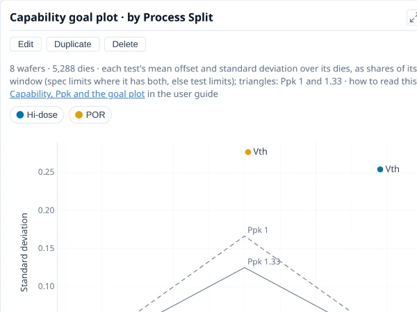

*Each test with both limits placed by how far its mean is off centre and how wide its spread is, as shares of its limit window. A test outside the solid triangle is short of Ppk 1.33.*

**Why it is useful.** A low Ppk can mean two different things with two different fixes: the mean is off centre (shift the process) or the spread is too wide (reduce the variation). The goal plot separates them.

**How to read it.** Each test with both limits is a point placed by how far its mean is from the centre of its limit window (left and right) and by its standard deviation (up), both as shares of the window. Every point on a triangle has the same Ppk: the dashed triangle is Ppk 1 and the solid one Ppk 1.33, so a test outside the solid triangle is short of 1.33. A point to the side is off centre; a point high up is too wide. Tests short of 1.33 are named. Colour by a split to see each test move between splits. Spec limits are used where a test has both kinds, otherwise the test limits, and the chart says which.

**Notes.**

- **Ppk is min(USL − mean, mean − LSL) ÷ 3σ**, with σ the plain standard deviation over every die, so the two limits are treated alike.
- **Below 30 dies a Ppk is a rough estimate**, and capability indices assume roughly normal values.
- **1.33 is a common target; yours may differ.** The triangles are a reading aid, not a statement of what is acceptable.
- **Only tests with both limits appear**; **Tests** narrows it to a set.

**Where to find it.** On **My plots**, choose **+ New plot** and set **Chart type** to Goal; with no tests chosen it draws every test with both limits.

<details markdown="1">
<summary>The plot as JSON</summary>

See [Using a plot's JSON](#using-a-plots-json).

```json
{ "chart": "goal", "fields": { "color": { "meta": "processSplit" } } }
```

</details>

**See also.** [Process capability](#process-capability), [Control chart](#control-chart).

### Part average testing (PAT)

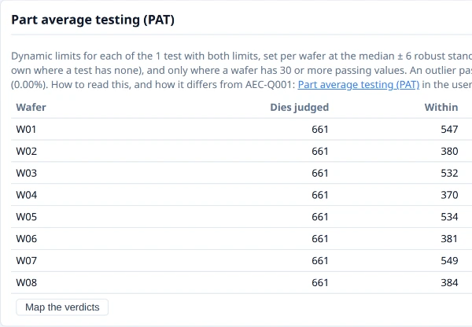

*Dies outside part average testing limits, set from each wafer’s own spread of each test (the AEC-Q001 method), by wafer and by test.*

**Why it is useful.** A die can pass every test limit and still sit far from the distribution of its neighbours on a test. In automotive and other high-reliability work such a die is the kind of part part average testing (PAT) screens out. This card shows which dies PAT would have flagged, and which tests drive it.

**How to read it.** Per wafer, for every test with both limits, the PAT limits are the median of the dies that pass, plus and minus six robust sigma, never wider than the test's own limits. A die is *Within PAT limits*, a *PAT outlier* (it passes its bin and every test limit but is outside the PAT limits of at least one test) or *Fails* (already rejected by its bin or limits, so not an outlier). The card counts them per wafer and names the tests the outliers are outside on, and the Dies table has a **PAT** column. **Map the verdicts** opens a map of each wafer coloured by verdict.

**Notes.**

- **It shows what PAT would have flagged; it is not the screening.** Screening belongs in the test programme under a documented procedure. The method follows the robust statistics of AEC-Q001 Rev D (the median, and the interquartile range ÷ 1.35, with limits of six robust sigma), here per wafer, and nothing here claims conformance.
- **A wafer needs 30 or more passing values on a test**, and some spread, before it has PAT limits for it. The floor of 30 is ours, not the guideline's.
- **Every test with both limits is judged.** The card does not check whether a test's distribution suits outlier analysis, and a lopsided test gets the same symmetric limits; the card lists the tests whose middle half of values is lopsided, without changing their limits.
- **Neighbourhood screens** (a good die in a bad neighbourhood) are not part of the guideline and are not in this card.

**Where to find it.** **Insights ▸ Overview**. As a plot, **PAT** is a field for colour, categories and panels, and a wafer's PAT limits can be drawn as dotted lines. The method and its differences from the guideline are in the user guide's [Part average testing (PAT)](user-guide.md#1012-part-average-testing-pat).

**See also.** [PAT verdict map](#pat-verdict-map), [Process capability](#process-capability), [Scatter plot](#scatter-plot).

---

## Comparing groups and finding causes

### What divides yield

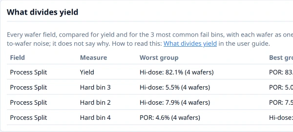

*The wafer and lot fields ranked by how strongly they divide yield, as places to look for a cause.*

**Why it is useful.** When yield differs between wafers the next question is "what do the low ones have in common?": a lot, a process split, a probe card, a test date. This table asks that of every wafer field at once and ranks them, so you start with the field that separates the wafers most clearly instead of trying them one by one.

**How to read it.** Each row is one wafer field, compared for yield and for the rate of each of the five most common fail bins. Each wafer counts as one value (a bin's value is its share of the wafer's judged dies), so *n* is wafers. Rows are ranked by **q**: Welch's p value adjusted for every comparison in the table, so a low q says the groups differ by more than wafer-to-wafer noise would give. A row names the worst and best group with their mean over their wafers and the gap in percentage points. The **Group by** button on a row regroups the whole tab by that field.

**Notes.**

- **A low q says where to look, not why.** It means the groups differ, not that the field caused it. Two fields that change together (a lot and its start date) cannot be told apart by the wafers; the card says which fields it could not separate.
- **It needs wafers to compare.** The table appears with four or more wafers and wafer fields that take more than one value. A field that gives every wafer its own value cannot be tested, and the card names it.
- **Many comparisons, a few false positives.** The adjustment (Benjamini–Hochberg) controls this across the table, but a field with a q near the limit is a suggestion.
- **Tool, chamber and probe-card fields appear only when your application supplies them as wafer attributes.**

**Where to find it.** **Insights ▸ Overview**, below the region charts. It follows **Group by** and any filter you have set.

**See also.** [Comparison by group](#comparison-by-group), [Yield by wafer](#yield-by-wafer). [What divides yield](user-guide.md#103-what-divides-yield) and [Comparing groups of wafers](user-guide.md#102-comparing-groups-of-wafers) in the user guide give the method.

### Comparison by group

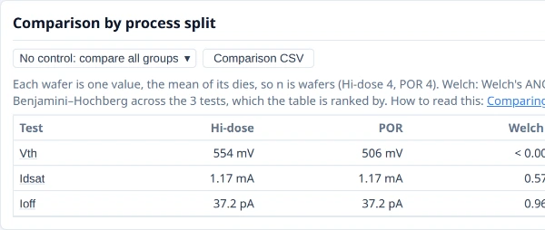

*Yield and each test compared between groups, counting each wafer once, with how likely a difference this large is by chance.*

**Why it is useful.** After a split experiment, a corner lot or a tool change, the question is whether the groups really differ. This table answers it test by test, counting each wafer once, so a few wafers cannot be made to look like thousands of dies.

**How to read it.** Each row is yield or a test; each column a group, with its mean over its wafers. The columns beside them are the evidence. **Welch p** answers: if the groups had the same true mean, how often would wafer means differ at least this much by chance? **Rank p** asks the same on the ranks, so one odd wafer cannot drive it (approximate, and marked so, with fewer than five wafers in a group). **q** corrects p for looking at many tests at once (Benjamini–Hochberg), and the table is sorted by it: read q, not p, when scanning many tests. **Largest shift** is the size of the effect, in wafer-to-wafer standard deviations and, where the test has both limits, as a share of the limit window. Choosing a **control** group adds each other group's difference from it, with its p adjusted for the number of groups compared (Holm).

**Notes.**

- **Each wafer is one value.** With two or three wafers in a group many real differences come out inconclusive. That is the true state of the evidence, not a fault; more wafers settle it.
- **A small p is not an important difference.** A tiny p with a tiny shift is real but unimportant; a large shift with a poor p needs more wafers.
- **A group with fewer than two wafers is left out and named.**
- **Nothing here says why** groups differ; the [difference map](#difference-map) shows where on the wafer.

**Where to find it.** **Insights ▸ Distributions**, once **Group by** is on, and the **Comparison CSV** button saves it. The method is in the user guide's [Comparing groups of wafers](user-guide.md#102-comparing-groups-of-wafers).

**See also.** [What divides yield](#what-divides-yield), [Difference map](#difference-map), [Box plot](#box-plot).

---

## Ways a plot is built

### Bar chart

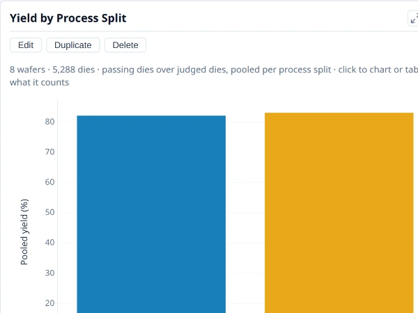

*A count, a share or a summary value for each category, side by side.*

**Why it is useful.** One number per category, side by side: yield by wafer, split or lot, a count of dies by bin, a pass rate by test. It is the workhorse of the plots, and the shape behind the yield and bin cards.

**How to read it.** One bar per category, its height the combined value (chosen with **Combine values by**) or a count when no value is chosen. A category can be a wafer attribute (a lot, a split), which separates whole wafers, or a die region (a ring, a reticle cell, a bin), which separates the dies within each wafer. **Colour** splits each category further. **Colours** chooses how the colours sit: side by side, each colour as a share of its own total (so groups of different sizes compare), stacked, or as 100% of the category. **Values on the bars** writes each value at the bar's end.

**Notes.**

- **Yield is pooled.** A bar of yield is passing dies over judged dies, so a larger wafer weighs more in a group.
- **A pass rate is the share of judged dies that pass**, pooled over the dies in each bar.
- **Shares and stacking add values**, so they need a count or a sum.
- **A bar chart does not say whether bars differ.** For groups of wafers, the [comparison by group](#comparison-by-group) judges it.

**Where to find it.** On **My plots**, choose **+ New plot**, set **Chart type** to Bar, **Categories (X axis)** and **Values (Y axis)**.

<details markdown="1">
<summary>The plot as JSON</summary>

See [Using a plot's JSON](#using-a-plots-json).

```json
{ "chart": "bar", "fields": { "x": { "meta": "processSplit" }, "y": { "builtin": "yield" }, "color": { "meta": "processSplit" } } }
```

</details>

**See also.** [Pareto](#pareto), [Stacked bars and shares](#stacked-bars-and-shares), [Yield by wafer](#yield-by-wafer).

### Pareto

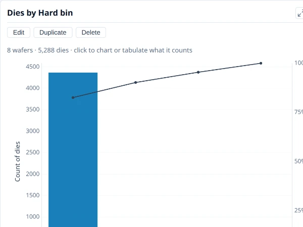

*Categories largest first with a line for their running share, to show which few account for most of the total.*

**Why it is useful.** To see which few categories account for most of a total: bins, failing tests, wafers, sites. Ordering largest first and drawing the running share makes the answer to "what first?" plain.

**How to read it.** Bars run from the largest category to the smallest, and the line is the running share of the total, so the point where it crosses 80% (or whatever share matters to you) says how many categories carry that share. It is an ordinary [bar chart](#bar-chart) with the categories in value order.

**Notes.**

- **The line is a share of everything counted**, including any passing category, so it starts high when one category dominates.
- **Show the first** limits the chart to the top categories and counts the rest in a note.
- **Largest first by value**, not alphabetically: a pareto answers a ranking question.

**Where to find it.** On **My plots**, make a bar chart, set **Order** to Largest first and switch on **Cumulative line (pareto)**. The Insights [bin pareto](#bin-pareto) is this chart.

<details markdown="1">
<summary>The plot as JSON</summary>

See [Using a plot's JSON](#using-a-plots-json).

```json
{ "chart": "bar", "fields": { "x": { "builtin": "hbin" }, "color": { "none": true } }, "sort": "value", "cumulative": true }
```

</details>

**See also.** [Bin pareto](#bin-pareto), [Bar chart](#bar-chart).

### Stacked bars and shares

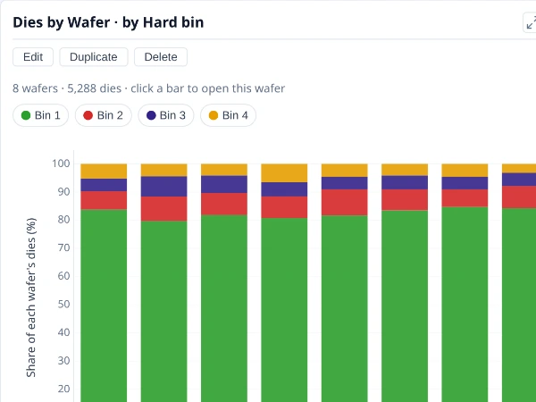

*Each bar split into its colours, as counts or as each colour’s share of its own total, to show what a category is made of.*

**Why it is useful.** Colouring a bar splits it into what it is made of: each wafer's bin mix, each lot's failing bins. Reading the bars as shares compares groups of different sizes by composition, not by count.

**How to read it.** Colour a bar chart by a field, then choose **Colours**: *Stacked* puts each category's colours one on another, so the total is the bar; *100%* makes each category one full bar, each colour its share of the category; *Share of colour* leaves the colours side by side, each as a share of its own total across the categories. Stacked shows how much; 100% shows what it is made of.

**Notes.**

- **Shares and stacking add values**, so they need a count or a sum, not a mean.
- **Compare composition with 100%, size with stacked.** A 100% bar hides how many dies a category has.
- **Many colours need many hues.** A field with dozens of values is hard to read stacked; filter or order it first.

**Where to find it.** On **My plots**, make a bar chart and put the field to split by in **Colour**, then choose **Colours**.

<details markdown="1">
<summary>The plot as JSON</summary>

See [Using a plot's JSON](#using-a-plots-json).

```json
{ "chart": "bar", "fields": { "x": { "builtin": "wafer" }, "color": { "builtin": "hbin" } }, "stack": "percent" }
```

</details>

**See also.** [Bar chart](#bar-chart).

### Nested categories

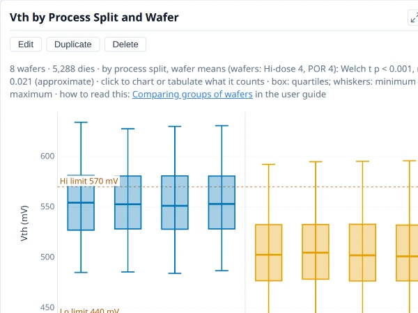

*A box or bar with categories inside categories, such as lots with their wafers, to show whether variation sits between or within the groups.*

**Why it is useful.** Variation lives at several levels: between splits, between wafers within a split, between dies within a wafer. Nesting categories (wafers inside their split, say) shows which level carries the variation, which decides what to fix and how many wafers a comparison needs.

**How to read it.** A box or bar with categories inside categories: an outer field (the split) with the inner one (the wafers) laid out under it. If the boxes of different splits sit apart while the wafers inside one split agree, the variation is between the groups; if wafers of one split spread as widely as the groups do, it is between wafers.

**Notes.**

- **Each box is dies.** Wafers inside a split are the units that count when judging whether the splits differ; use the [comparison by group](#comparison-by-group) for that, which counts each wafer once.
- **More levels mean thinner boxes.** With few dies in an inner category, the boxes are noisy.

**Where to find it.** On **My plots**, make a box or bar chart and use **+ Add a level** under **Categories (X axis)** to nest a second field.

<details markdown="1">
<summary>The plot as JSON</summary>

See [Using a plot's JSON](#using-a-plots-json).

```json
{ "chart": "box", "fields": { "x": [ { "meta": "processSplit" }, { "builtin": "wafer" } ], "y": { "test": 1060, "name": "Vth" }, "color": { "meta": "processSplit" } } }
```

</details>

**See also.** [Box plot](#box-plot), [Bar chart](#bar-chart).

### Panels (small multiples)

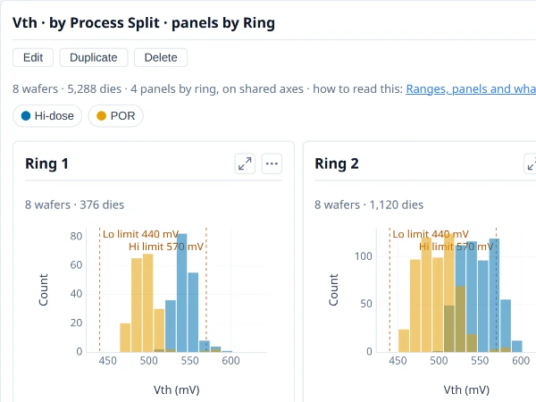

*One small chart per value of a field, on shared axes, to compare the same view across groups side by side.*

**Why it is useful.** The same chart repeated for each value of a field, side by side, lets the eye compare groups without overlaying them. A histogram per ring shows whether the distribution shifts from the centre to the edge, and the same view per lot or split shows whether the groups have the same shape.

**How to read it.** One panel per value of the field, all on shared axes and colours, so panels can be compared directly. A field that is a wafer attribute (a split, a lot) takes whole wafers into each panel; a die region (a ring, a site) takes the dies in it. Read across the panels for what changes and down within one for what stays.

**Notes.**

- **A panel here is one small chart**, not the Summary panel.
- **Shared axes can squash a small panel.** A group with few values draws small against a group with many; that is the cost of comparing like with like.
- **Many values make many panels.** A field with dozens of values is better as colours or categories.

**Where to find it.** On **My plots**, choose a field in **Panels** in the plot's settings.

<details markdown="1">
<summary>The plot as JSON</summary>

See [Using a plot's JSON](#using-a-plots-json).

```json
{ "chart": "histogram", "fields": { "y": { "test": 1060, "name": "Vth" }, "color": { "meta": "processSplit" }, "facet": { "builtin": "ring" } } }
```

</details>

**See also.** [Box plot](#box-plot), [Scatter plot](#scatter-plot), [Histogram](#histogram).

---

## Tables

### Statistics table

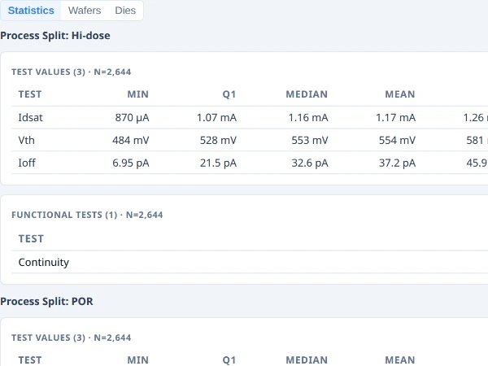

*One row per test and group: the count, mean, spread, extremes, limits and capability, to read the numbers behind the charts.*

**Why it is useful.** The charts show shapes; the table gives the numbers behind them, to read exactly, copy into a report or export.

**How to read it.** The **Test Values** table has a row per test: the count, minimum, quartiles, mean, standard deviation, Ppk, the limits and the limit yield, with its N stated. The **Functional Tests** table gives the pass rate of each go/no-go test. With **Group by** on there is one set per group. It follows the same scope as the charts: Group by, **Show**, and any filter.

**Notes.**

- **N is stated and so is what was left out.** A value outside a test's validity limits is excluded and counted in an **Excl.** column, never silently dropped.
- **Cp and Cpk in the table use the pooled within-wafer standard deviation**, where the capability chart's Ppk uses the plain one.
- **Export CSV writes numbers in full**, as plain numbers, not the formatted text on screen, with the unit in the column heading; **Copy** puts it on the clipboard for a spreadsheet.

**Where to find it.** **Insights ▸ Data**, with **Statistics** chosen.

**See also.** [Dies table](#dies-table), [Process capability](#process-capability).

### Dies table

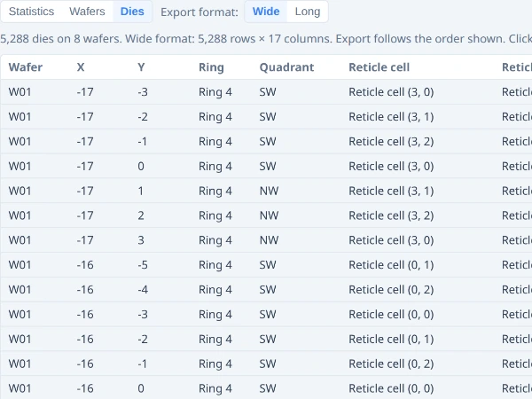

*One row per die with its position, bin and values, to see exactly which dies a chart counts; it exports to CSV.*

**Why it is useful.** It is the die-level truth behind any chart: which dies, with which results. When a chart says "37 dies", this is the 37 rows.

**How to read it.** One row per die: wafer, X, Y, ring, quadrant (and reticle cell and shot when a reticle is set), site, bins, a column for each test, and the wafer's metadata. Click a column heading to sort by it, again to reverse; a die with no value sorts last. Only the rows in view are drawn, so a lot of hundreds of thousands of dies scrolls smoothly. **Click a row** to show that die on its map, ringed, on its own card in a gallery.

**Notes.**

- **Export format** chooses the file's layout: *Wide* has a column per test, *Long* has a row per die per test (a die with no result for a test has no row), the shape statistics tools prefer. The note under the buttons says how many rows the file will have and warns when that is more than a spreadsheet can open (1,048,576).
- **Copy is offered for tables up to about 200,000 cells.**
- **A PAT column and, where there are outliers, a PAT tests column** are included when part average testing applies.

**Where to find it.** **Insights ▸ Data**, with **Dies** chosen; also from a selection's right-click menu, over just those dies.

**See also.** [Wafers table](#wafers-table), [Statistics table](#statistics-table).

### Wafers table

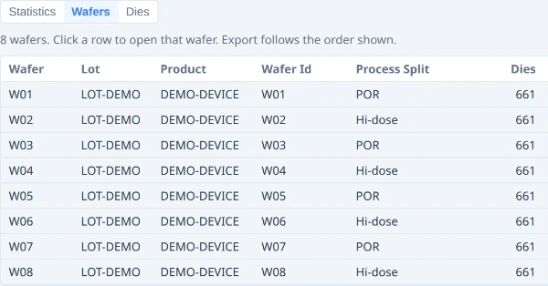

*One row per wafer with its attributes and its yield, to check what each wafer is and to compare them.*

**Why it is useful.** To check what each wafer is (its lot, its split, its other attributes) next to how it did, and to compare wafers numerically, sorted by whatever matters.

**How to read it.** One row per wafer: lot, split and any other metadata, the die counts, the yield (the same figure as the yield chart), and the mean of each test (the first 50). Click a heading to sort; sorting by a test's mean shows how splits separate.

**Notes.**

- **Yield here is the wafer's own**, passing dies over judged dies, the figure the yield chart draws.
- **Only the first 50 tests have a mean column**; the Dies table has them all.
- **Attributes are named as your application names them**, in the same words as Group by and the plots.

**Where to find it.** **Insights ▸ Data**, with **Wafers** chosen.

**See also.** [Dies table](#dies-table), [Yield by wafer](#yield-by-wafer).
